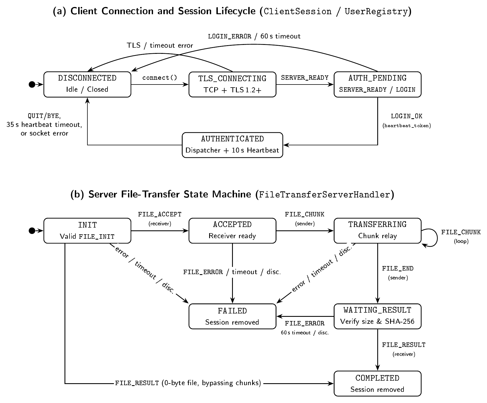
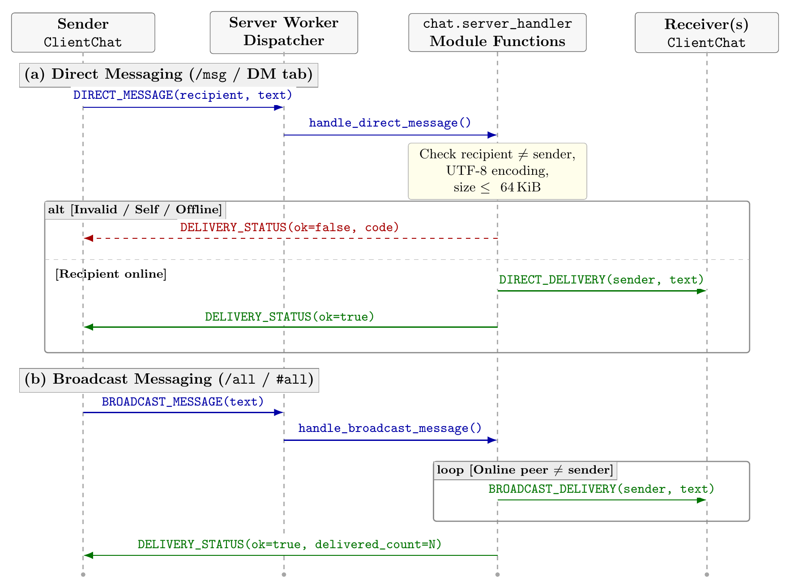
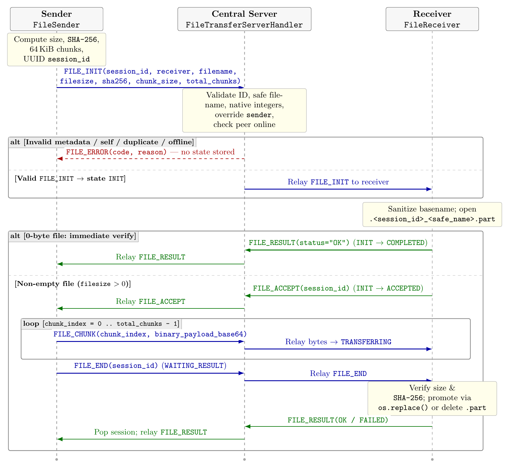

# Kiến trúc Hệ thống

Ứng dụng được thiết kế theo kiến trúc phân lớp rõ rệt giữa tầng truyền tải/hạ tầng mạng, tầng nghiệp vụ cộng tác (chat và truyền file) và tầng giao diện người dùng.

## Tổng quan phân lớp

```text
+-------------------------------------------------------------------+
|                           Tầng Giao diện                          |
|   - ui/cli.py (prompt_toolkit, bottom toolbar tiến độ 1 dòng)     |
|   - ui/gui/   (PySide6: MainWindow, SessionController, Models)    |
+---------------------------------+---------------------------------+
                                  |
             +--------------------+--------------------+
             v                                         v
+-------------------------+               +-------------------------+
|    Tầng Chat (chat/)    |               | Tầng Truyền file        |
|  - client_chat.py       |               | (transfer/)             |
|  - server_handler.py    |               |  - sender.py            |
+------------+------------+               |  - receiver.py          |
             |                            |  - server_handler.py    |
             |                            |  - integrity.py         |
             |                            +------------+------------+
             +--------------------+--------------------+
                                  v
+-------------------------------------------------------------------+
|                     Tầng Hạ tầng & Chung                          |
|   - infrastructure/: server.py, client_connection.py,             |
|                      udp_service.py, user_registry.py,            |
|                      message_dispatcher.py, authentication.py,    |
|                      security.py                                  |
|   - common/: protocol.py, message_types.py, app_config.py,        |
|              console.py                                           |
+-------------------------------------------------------------------+
```

## Chi tiết từng thành phần

### 1. `common/` — Giao thức đóng khung & Cấu hình
- `app_config.py`: Nạp cấu hình trực tiếp từ `config.json` (dùng `config.example.json` khi chưa có `config.json`), kiểm tra đầy đủ khóa bắt buộc/kiểu/miền giá trị hợp lệ và định nghĩa `DEFAULT_DOWNLOADS_DIR` (`downloads/`).
- `message_types.py`: Định nghĩa hằng số loại thông điệp và mã lỗi truyền file thống nhất.
- `protocol.py`: Cài đặt TCP message framing `[4-byte unsigned big-endian (!I) payload length][UTF-8 JSON]`, sử dụng `recv_exact` xử lý phân mảnh/dính gói TCP và chặn khung vượt quá `MAX_PAYLOAD_SIZE` (`1048576` byte).
- `console.py`: Cấu hình luồng `stdin`/`stdout`/`stderr` UTF-8 trên Windows để hiển thị tiếng Việt ổn định.

### 2. `infrastructure/` — Hạ tầng kết nối, Bảo mật & Phiên
- `security.py`: Khởi tạo `ssl.SSLContext` cho server và client (TLS tối thiểu `TLSv1.2`, kiểm chứng chứng chỉ server theo CA `certs/dev-ca.pem` và SNI `collab-server.local`).
- `authentication.py`: Hàm `normalize_username()` chuẩn hóa khoảng trắng và ép quy tắc 3–20 ký tự ASCII gồm chữ cái, chữ số hoặc `_`.
- `user_registry.py`: Lưu trữ luồng kết nối, địa chỉ `(ip, port)` và trạng thái phiên trực tuyến theo cơ chế thread-safe (`threading.Lock`). Hỗ trợ kiểm tra định danh socket (`remove_if_same`) khi dọn dẹp để ngắt kết nối trễ của phiên cũ không ghi đè hay hủy tài nguyên của phiên vừa đăng nhập lại; xác thực `UDP_HEARTBEAT` qua HMAC-SHA256 (kiểm tra trước định dạng 64 ký tự hex ASCII để chặn chữ ký Unicode gây lỗi `TypeError`) và chống phát lại bằng mốc thời gian tăng nghiêm ngặt.
- `message_dispatcher.py`: Định tuyến thông điệp JSON theo trường `type` thông qua `ClientContext` (tách biệt logic nghiệp vụ khỏi socket thô).
- `udp_service.py`: Đáp ứng bản tin `UDP_DISCOVER`, tiếp nhận `UDP_HEARTBEAT` ký HMAC và chạy nền dọn các phiên hết hạn heartbeat (`timeout_seconds = 35`). Mỗi vòng lặp/gói tin được cô lập ngoại lệ với logging đầy đủ để một datagram sai định dạng không thể làm dừng luồng UDP; khi phiên hết hạn, dịch vụ tự động kích hoạt dọn dẹp các phiên truyền file liên quan.
- `server.py`: Đón kết nối TCP, thực hiện TLS handshake (giới hạn timeout pre-login tránh giữ socket treo), đăng ký phiên trong `UserRegistry`, và phân phối thông điệp tới handler của `chat` và `transfer`.
- `client_connection.py`: Đảm nhận UDP discovery trên các địa chỉ broadcast/hướng đích (bỏ qua loopback không hợp lệ khi không cần thiết và loại bỏ phản hồi chứa kiểu dữ liệu sai như `bool` cho port/version), kết nối TLS, đăng nhập lấy `heartbeat_token`, chạy luồng nền đọc gói tin, gửi định kỳ UDP heartbeat có ký HMAC và cung cấp API công khai (`get_tls_details()`, `receiver_thread`) cho tầng UI.



### 3. `chat/` — Nhắn tin trực tuyến
- `client_chat.py` & `server_handler.py`: Kiểm soát độ dài tối đa (`MAX_CHAT_MESSAGE_BYTES = 65536` byte UTF-8), kiểm tra tính hợp lệ UTF-8, ngăn người dùng tự nhắn cho chính mình, chuyển tiếp `BROADCAST_MESSAGE` tới tất cả các client khác đang online và `DIRECT_MESSAGE` tới đích cụ thể kèm phản hồi `DELIVERY_STATUS`.



### 4. `transfer/` — Truyền tập tin & Toàn vẹn dữ liệu
- `integrity.py`: Tính toán `SHA-256` đọc theo luồng khối, kiểm tra kích thước/hash tệp đích (`verify_file`), đồng thời cung cấp các hàm kiểm tra an toàn dùng chung: `is_valid_transfer_id` (chặn khoảng trắng, `..`, ký tự phân cách đường dẫn), `is_safe_filename`, `sanitize_filename` (lọc path traversal Windows/POSIX về basename an toàn), và `parse_non_negative_int` (chặn giá trị `bool`, số âm và kiểu không hợp lệ).
- `server_handler.py`: Điều phối phiên truyền file (`ServerTransferSession`) bằng máy trạng thái chặt chẽ (`INIT -> ACCEPTED -> TRANSFERRING -> WAITING_RESULT -> COMPLETED | FAILED`) dưới một khóa đồng bộ thống nhất trước khi thực hiện I/O mạng. Khi chuyển tiếp tới người nhận thất bại do lỗi tuần tự hóa (`ValueError`), bridge chỉ hủy phiên truyền thay vì đóng nhầm socket người nhận; lỗi socket (`OSError`) mới kích hoạt ngắt kết nối và thông báo `ERR_PEER_DISCONNECTED` cho bên còn lại. Server định kỳ dọn các phiên treo quá `60s`.
- `sender.py`: Gồm `FileSender` (chia chunk `65536` byte, gắn cờ `started` chống kích hoạt trùng luồng gửi khi nhận nhiều `FILE_ACCEPT`, thu dọn an toàn khi hủy giữa chừng, gắn cờ `is_broadcast` trên `FILE_INIT` khi phát chung) và `ClientFileTransferManager` (đóng/mở gói `binary_payload_base64` qua JSON, cô lập lỗi Base64 theo đúng `session_id` bị hỏng mà không làm gián đoạn các phiên đang tải khác, giữ nguyên `direction`/`peer`/`is_broadcast` trong sự kiện gửi UI, và truyền thống nhất `DEFAULT_DOWNLOADS_DIR` cho `FileReceiver`).
- `receiver.py`: Khởi tạo tệp tạm `.<session_id>_<safe_name>.part` trong thư mục `downloads/` (`DEFAULT_DOWNLOADS_DIR`), hoàn tất ngay lập tức đối với tệp 0 byte, ghi tuần tự theo `chunk_index` (chặn `bool`), kiểm tra dung lượng & `SHA-256` trước khi đổi tên nguyên tử sang tên đích (tự thêm hậu tố `(1)`, `(2)` nếu trùng tên), và dọn các tệp `.part` mồ côi lúc khởi động mà không đụng tới các tập tin có `.part` nằm giữa tên như `archive.part1.rar`.



### 5. `ui/` — Giao diện Desktop GUI & CLI
- `ui/cli.py`: Sử dụng `prompt_toolkit` tách vùng nhập lệnh với đầu ra đồng bộ qua khóa in; hỗ trợ hàng đợi gửi file broadcast `/sendfile all <path>` (tự động hoàn tác hàng đợi nếu yêu cầu `LIST_ONLINE` lỗi) và thông báo cú pháp chuẩn cho các lệnh thiếu tham số.
- `ui/gui/controller.py`: `SessionController` điều phối kết nối, chat và truyền file trên `ThreadPoolExecutor`, điều tiết tần suất cập nhật UI (~15 Hz), gắn `batch_id`/`is_broadcast` theo ngữ cảnh cho từng đợt gửi `#all`, ép kiểu an toàn các số đo tiến độ và khóa nhận tác vụ mới khi `shutdown_sync()` được gọi.
- `ui/gui/models.py`: `ChatSessionStore` lưu lịch sử, trạng thái chưa đọc theo từng hội thoại và gộp tiến độ đợt gửi file `#all` (`upsert_broadcast_batch_file`) thành một thẻ tổng hợp; `MessageListModel` giới hạn bộ nhớ 1000 tin nhắn mỗi cuộc trò chuyện; `MessageBubbleDelegate` dùng chung hàm định dạng tiêu đề cho cả pha đo và vẽ, bật `Qt.TextFlag.TextWrapAnywhere` để không cắt chữ ở các chuỗi liền nhau dài.
- `ui/gui/main_window.py`: Kiểm tra trạng thái kết nối và giới hạn `MAX_CHAT_MESSAGE_BYTES` trước khi đẩy tin nhắn lên feed cục bộ hoặc xóa ô nhập, đọc lại danh sách `online_users` mới nhất ngay sau khi hộp thoại chọn tệp đóng lại khi gửi broadcast, định tuyến cả thẻ gộp phía người gửi lẫn thẻ nhận file có `is_broadcast=True` vào `#all` (trong khi bảng Inspector vẫn theo dõi chi tiết từng peer), mở thư mục tải về thống nhất tại `DEFAULT_DOWNLOADS_DIR` (`downloads/`), và làm sạch trạng thái UI giữa các lần đăng nhập.
