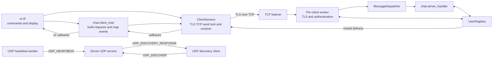
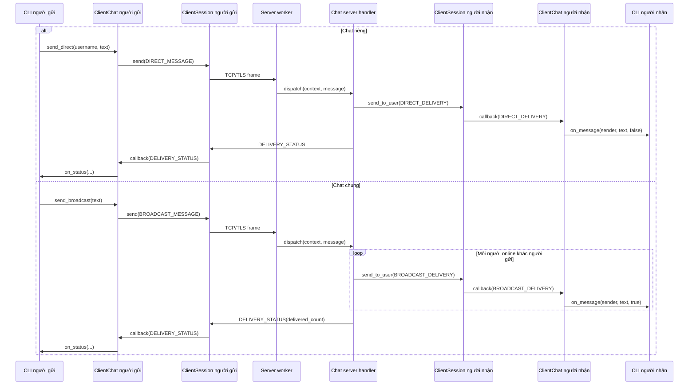
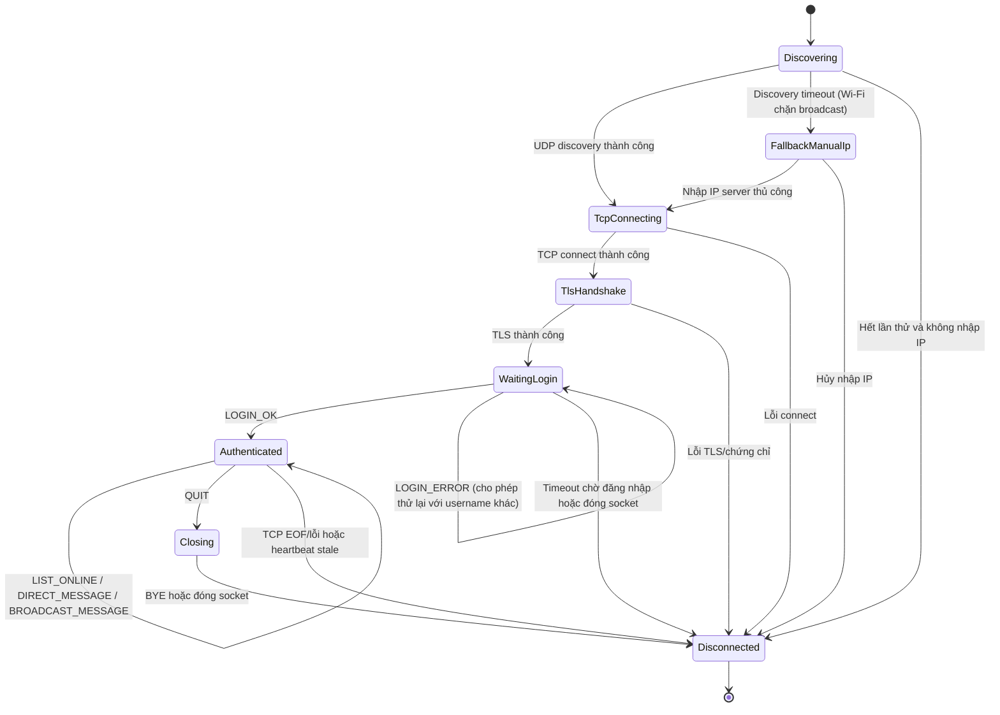
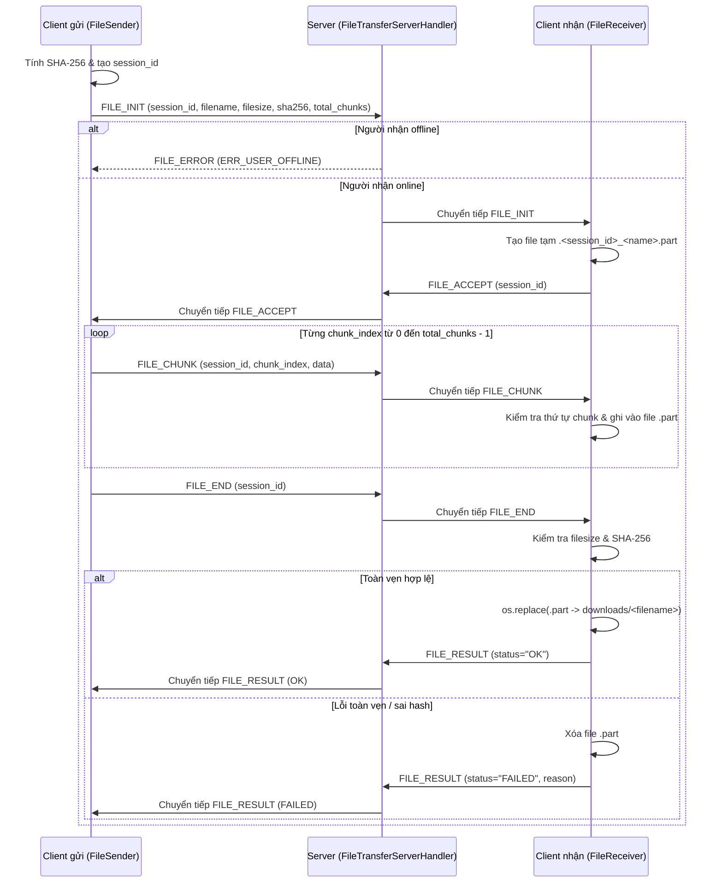

# Kiến trúc ứng dụng và luồng xử lý

## Phạm vi hiện tại

Ứng dụng tách kết nối mạng, xử lý chat, truyền file và giao diện thành các module riêng. Server cung cấp đăng nhập, danh sách online, chat riêng, chat chung và định tuyến phiên truyền file (Cut-Through Streaming Relay). Client dùng một session TCP/TLS duy nhất; một luồng nền đọc TCP rồi chuyển bản tin đến callback theo `type`.

## Thành phần

- **CLI (`ui/cli.py`)** đọc lệnh, hiển thị tin đến, danh sách online, trạng thái gửi và thanh tiến trình truyền file thời gian thực ngay trên dòng nhập lệnh. CLI không tự đóng frame TCP.
- **Chat client (`chat/client_chat.py`)** tạo `DIRECT_MESSAGE`/`BROADCAST_MESSAGE`, kiểm tra nội dung trước khi gửi, và chuyển phản hồi chat đến callback giao diện.
- **Client session (`infrastructure/client_connection.py`)** dò server qua UDP, thiết lập TCP/TLS, đăng nhập, gửi bản tin có khóa, nhận bản tin ở một luồng duy nhất và gửi heartbeat UDP.
- **TCP listener và worker (`infrastructure/server.py`)** nhận kết nối đa client, hoàn tất TLS, xác thực LOGIN và dispatch request của session đã đăng nhập.
- **Message dispatcher (`infrastructure/message_dispatcher.py`)** ánh xạ loại request tới handler `(ClientContext, message)`.
- **Chat server handler (`chat/server_handler.py`)** kiểm tra payload, chuyển tin riêng/chung bằng `ClientContext` và trả `DELIVERY_STATUS`.
- **UserRegistry (`infrastructure/user_registry.py`)** lưu username, socket, địa chỉ, heartbeat token và send lock cho mỗi session online.
- **Common utilities (`common/`)** cung cấp protocol framing JSON 4 byte và cấu hình console UTF-8 cho server/CLI.
- **TLS (`infrastructure/security.py`)** dùng TLS 1.2 trở lên. Client xác minh CA và tên server `collab-server.local`.
- **Transfer (`transfer/`)** gồm `sender.py` (chia chunk 64 KB, luồng gửi nền, quản lý tiến trình CLI), `receiver.py` (nhận chunk vào file tạm `.part`, chống Path Traversal, đổi tên nguyên tử), `server_handler.py` (quản lý phiên truyền file và chuyển tiếp streaming qua server) và `integrity.py` (kiểm tra kích thước và băm SHA-256).

## Sơ đồ thành phần

## Luồng kết nối và đăng nhập

1. `ClientSession.connect()` gọi UDP discovery để tìm IP server và TCP port.
2. Client kết nối TCP rồi hoàn tất TLS handshake. Client xác minh CA và hostname.
3. Server gửi `SERVER_READY`; client gửi `LOGIN` với username.
4. Server kiểm tra username, đăng ký session trong `UserRegistry` và trả `LOGIN_OK` cùng heartbeat token.
5. CLI đăng ký callback cho tin chat, online list, lỗi và BYE.
6. `ClientSession.start()` bắt đầu một luồng đọc TCP và một luồng gửi UDP heartbeat.

## Luồng chat riêng

1. CLI nhận `/msg <username> <nội dung>` và gọi `ClientChat.send_direct()`.
2. `ClientChat` kiểm tra recipient/nội dung và gửi `DIRECT_MESSAGE` qua `ClientSession.send()`.
3. Server worker đưa request đến handler chat riêng qua `MessageDispatcher`.
4. Handler dùng username từ `ClientContext`, kiểm tra người nhận/nội dung rồi gọi `context.send_to_user()`.
5. Nếu người nhận online, server gửi `DIRECT_DELIVERY`; nếu offline, server trả `DELIVERY_STATUS` với `RECIPIENT_OFFLINE`.
6. Luồng nhận client dispatch `DIRECT_DELIVERY`/`DELIVERY_STATUS` đến `ClientChat.handle_message()`, rồi callback giao diện hiển thị kết quả.

## Luồng chat chung

1. CLI nhận `/all <nội dung>` hoặc văn bản thường và gọi `ClientChat.send_broadcast()`.
2. Client gửi `BROADCAST_MESSAGE`; server lấy sender từ session đã đăng nhập.
3. Handler gửi `BROADCAST_DELIVERY` đến các user online khác, không gửi lại cho người gửi.
4. Server trả `DELIVERY_STATUS` với `delivered_count`; CLI tự hiển thị bản tin đã gửi của người gửi.
5. Các client nhận broadcast qua callback trong luồng TCP nền.

## Sequence diagram chat

*(Mã nguồn PlantUML chi tiết có tại [`docs/diagrams/chat_sequence.puml`](file:///d:/learneddoc/mmt/btl/Huy/Distributed-Client-Server-Collaboration-Application/docs/diagrams/chat_sequence.puml))*

## Luồng nhận và đồng thời

- Chỉ `_receive_loop()` đọc socket TCP sau đăng nhập; các module khác đăng ký handler theo `type`.
- `ClientSession.send()` giữ send lock chung trong lúc ghi frame. Chat và các module tích hợp sau này dùng cùng API để tránh frame bị xen byte.
- Callback được gọi trên luồng nhận. CLI dùng `_print_async()` để in sự kiện nền và hiện lại prompt khi đang nhập.
- Heartbeat chạy độc lập trên UDP; discovery và heartbeat không dùng framing TCP.

## Đăng xuất và dọn session

- CLI gọi `ClientSession.logout()`, gửi `QUIT` và chờ `BYE`.
- Server trả `BYE`, kết thúc worker và gọi `UserRegistry.remove_if_same()` để xóa session.
- `ClientSession.close()` dừng receiver/heartbeat và đóng TLS socket, kể cả khi kết nối gặp lỗi.
- Server cũng xóa session khi TCP đóng hoặc heartbeat quá hạn. Cấu hình hiện tại gửi heartbeat mỗi 10 giây và coi session stale sau 35 giây.

## State diagram kết nối client

## Luồng truyền file (File Transfer)

1. CLI nhận lệnh `/sendfile <username> <filepath>` và gọi `ClientFileTransferManager.send_file()`.
2. `FileSender` trích xuất metadata (`filename`, `filesize`, `sha256`, `chunk_size=65536`, `total_chunks`), sinh `session_id` (UUID) và gửi `FILE_INIT`.
3. `FileTransferServerHandler` xác thực metadata (kiểm tra kiểu số `filesize`, chống Path Traversal ở `filename`, kiểm tra tính nhất quán chunks), kiểm tra chống trùng `session_id`, xác thực người gửi từ `context.username`, kiểm tra người nhận đang online, khởi tạo phiên với trạng thái `INIT` vào `_active_sessions` và chuyển tiếp `FILE_INIT` tới người nhận.
4. `FileReceiver` bên nhận tạo file tạm `.{session_id}_{safe_filename}.part` trong thư mục `downloads/` (có cơ chế khóa file chống xóa nhầm khi chạy đa client) và phản hồi `FILE_ACCEPT` (nếu file rỗng `0 byte` thì hoàn tất ngay).
5. Server kiểm tra vai trò người gửi (bắt buộc từ receiver) và chuyển trạng thái phiên từ `INIT` sang `ACCEPTED`. Khi nhận `FILE_ACCEPT`, `FileSender` khởi chạy luồng nền `_send_chunks_worker` đọc tuần tự từng chunk `64 KB`, gửi `FILE_CHUNK` (server chuyển trạng thái sang `TRANSFERRING`, từ chối chunk gửi từ receiver) qua kết nối có khóa và kết thúc bằng `FILE_END`. Thanh tiến trình `[=====>---------] %` được cập nhật trực tiếp theo thời gian thực trên dòng prompt của cả hai đầu.
6. Khi nhận `FILE_END`, `FileReceiver` đóng file `.part`, gọi `verify_file()` kiểm tra đúng kích thước và mã băm SHA-256. Nếu khớp, đổi tên nguyên tử (`os.replace`) sang tên file chính thức (tự thêm `(1)`, `(2)` nếu trùng) và gửi `FILE_RESULT (status="OK")`. Nếu sai lệch hoặc đứt kết nối giữa chừng, xóa ngay file `.part` và báo lỗi. Server nhận `FILE_RESULT` chuyển phiên sang `COMPLETED` và giải phóng session khỏi `_active_sessions`.
7. Các phiên truyền file bị treo hoặc không hoạt động quá 60 giây sẽ được `prune_stale_sessions()` tự động thu hồi và dọn dẹp định kỳ mỗi chu kỳ heartbeat.

## Sequence diagram truyền file

*(Mã nguồn PlantUML chi tiết có tại [`docs/diagrams/file_transfer_sequence.puml`](file:///d:/learneddoc\mmt\btl\Huy\Distributed-Client-Server-Collaboration-Application/docs/diagrams/file_transfer_sequence.puml))*

## Giới hạn hiện tại

- `DELIVERY_STATUS.ok` đối với tin nhắn chat xác nhận server gửi được frame tới socket đích; với truyền file, `FILE_RESULT (OK)` xác nhận đầu nhận đã lưu và kiểm tra SHA-256 thành công.
- TLS bảo vệ toàn bộ kết nối TCP (bao gồm đăng nhập, chat và truyền file). UDP discovery/heartbeat không được TLS bảo vệ; heartbeat token hiện nằm trong datagram UDP plaintext.
