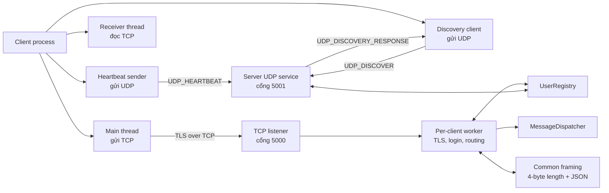
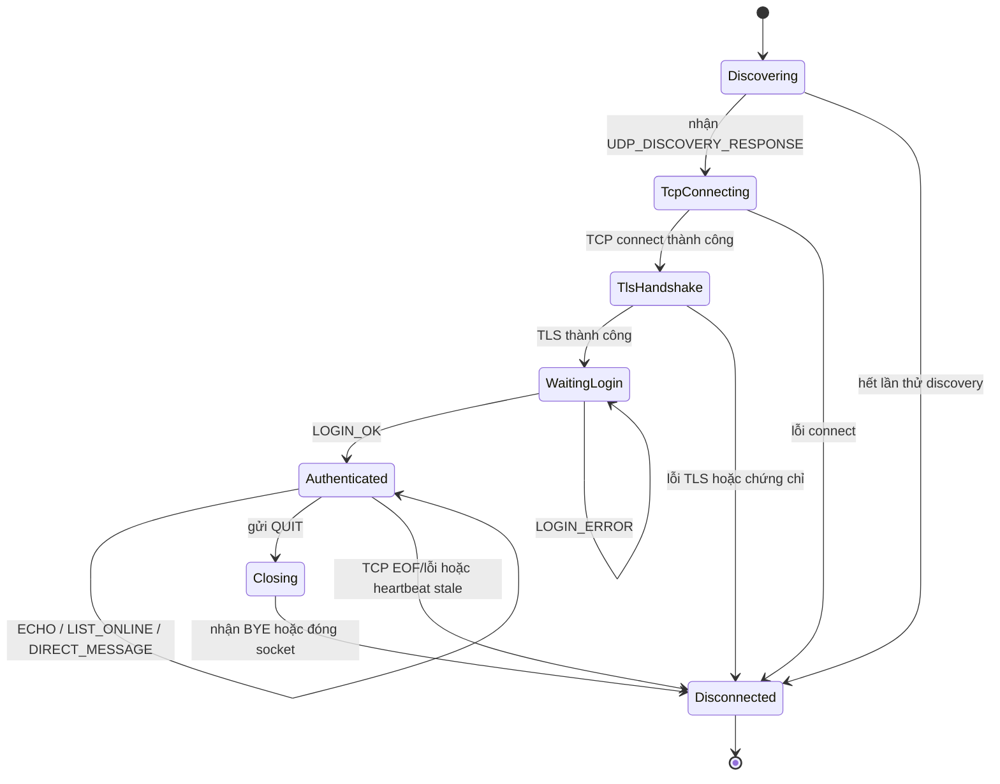

# Kiến trúc hệ thống và trạng thái kết nối

## Phạm vi hiện tại

Tài liệu mô tả trạng thái hạ tầng hiện có. `ECHO`, `LIST_ONLINE` và `DIRECT_MESSAGE` được đăng ký trong `MessageDispatcher`. `QUIT` vẫn được xử lý trực tiếp trong `infrastructure/server.py` vì nó kết thúc vòng đời connection. Handler chat nhóm và truyền file phía server của TV2/TV3 chưa được tích hợp trong phiên bản này.

## Thành phần

- **Client** tìm server bằng UDP discovery, kết nối TCP tới IP tìm được, xác minh TLS, đăng nhập và gửi request.
- **Client receiver** là luồng duy nhất đọc dữ liệu TCP sau đăng nhập. Luồng chính chỉ gửi request.
- **Client heartbeat sender** gửi UDP heartbeat định kỳ để server biết session còn hoạt động.
- **UDP service** nghe discovery và heartbeat trên `0.0.0.0:5001`.
- **TCP server** nghe trên `0.0.0.0:5000`, tạo worker thread cho mỗi kết nối và thực hiện TLS handshake trong worker.
- **UserRegistry** lưu username, địa chỉ client, TCP connection, heartbeat token, send lock và thời điểm heartbeat gần nhất.
- **MessageDispatcher** ánh xạ loại message tới handler đã đăng ký. Hiện đăng ký `ECHO` và `LIST_ONLINE`.
- **Common protocol** mã hóa dictionary thành JSON UTF-8 và đóng frame với header độ dài 4 byte.
- **TLS** bảo vệ TCP với TLS 1.2 trở lên. Client tin CA trong `certs/dev-ca.pem` và xác minh tên `collab-server.local`.

## Sơ đồ thành phần

## Luồng kết nối và đăng nhập

1. Client broadcast `UDP_DISCOVER` tới UDP cổng 5001.
2. Server trả `UDP_DISCOVERY_RESPONSE` gồm protocol version và TCP port. Client lấy IP server từ địa chỉ nguồn của phản hồi.
3. Client kết nối TCP tới IP đó, sau đó bắt đầu TLS handshake. Client xác minh chuỗi chứng chỉ và tên `collab-server.local`.
4. Sau khi TLS handshake thành công, server gửi `SERVER_READY` trong một frame TCP/TLS.
5. Client gửi `LOGIN`. Server chuẩn hóa username, tạo heartbeat token và đăng ký session trong `UserRegistry`.
6. Server trả `LOGIN_OK` gồm username và heartbeat token.
7. Client chuyển sang trạng thái authenticated, khởi động receiver và heartbeat sender. Main thread đọc input và gửi request TCP.

## Luồng định tuyến message

- Mỗi message TCP được đóng thành frame, giải mã từ JSON, rồi xử lý trên worker của kết nối đó.
- `ECHO`, `LIST_ONLINE` và `DIRECT_MESSAGE` được chuyển qua `MessageDispatcher` với cùng interface `handler(context, message)`.
- Handler `DIRECT_MESSAGE` dùng `ClientContext.send_to_user()` để gửi `DIRECT_DELIVERY` tới session người nhận và `ClientContext.send()` để trả `DELIVERY_STATUS` về người gửi.
- `QUIT` được xử lý trong connection handler: server trả `BYE`, kết thúc worker và dọn session.
- Một message không có handler được trả lỗi `UNKNOWN_TYPE`.

## Heartbeat và dọn session

Client gửi `UDP_HEARTBEAT` kèm token mỗi 10 giây. UDP service xác minh token và IP nguồn rồi cập nhật `last_heartbeat`. Nếu đã quá 35 giây không có heartbeat, registry xóa session và UDP service gọi `shutdown()` trên TCP connection để đánh thức worker đang chờ đọc.

Nếu TCP đóng hoặc worker gặp EOF/lỗi kết nối trước thời hạn heartbeat, `finally` trong `handle_client()` gọi `remove_if_same()` để xóa đúng session của connection đó.

## State diagram kết nối client

## Giới hạn bảo mật hiện tại

TLS chỉ bảo vệ dữ liệu TCP. UDP discovery và heartbeat không nằm trong TLS; heartbeat token được gửi nguyên dạng trong datagram UDP. Vì vậy heartbeat hiện phục vụ phát hiện session hoạt động, không phải cơ chế xác thực UDP chống giả mạo mạnh.
