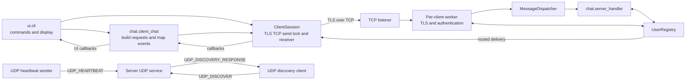
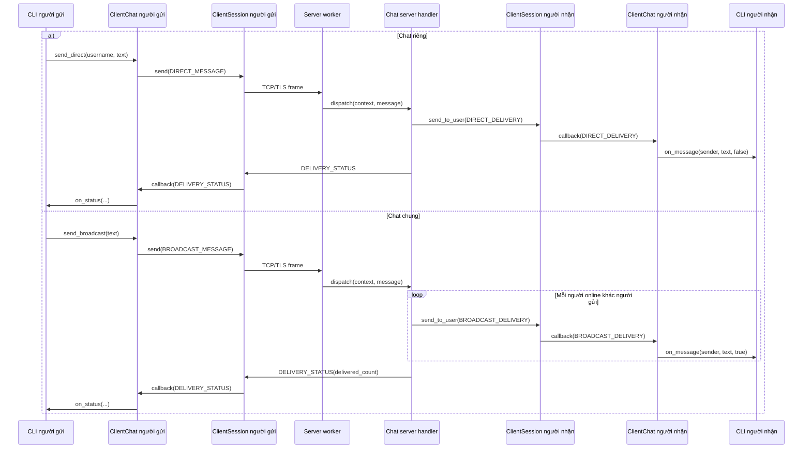
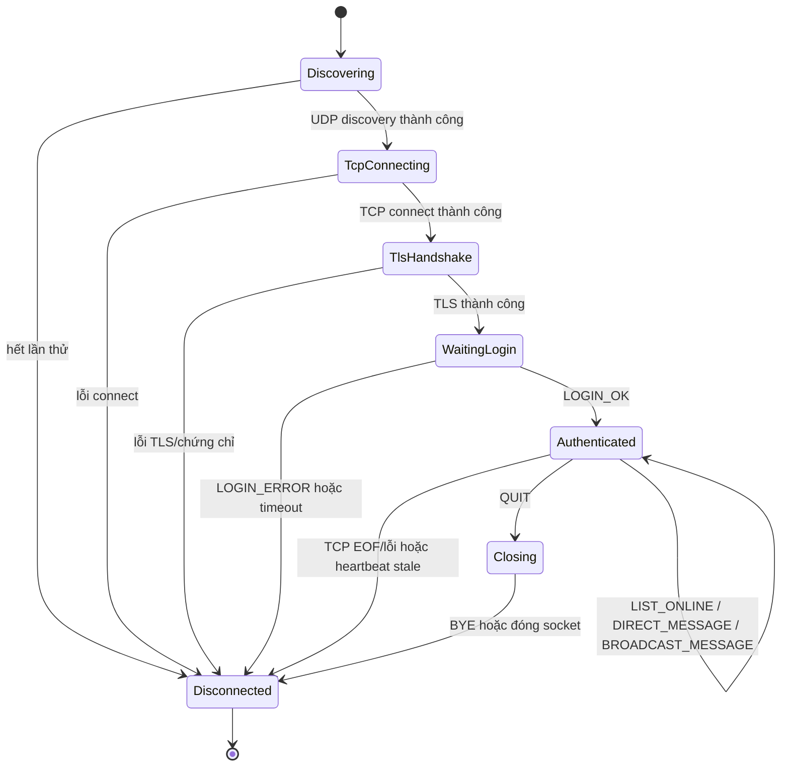

# Kiến trúc ứng dụng và luồng xử lý

## Phạm vi hiện tại

Ứng dụng tách kết nối mạng, xử lý chat và giao diện thành các module riêng. Server cung cấp đăng nhập, danh sách online, chat riêng và chat chung. Client dùng một session TCP/TLS duy nhất; một luồng nền đọc TCP rồi chuyển bản tin đến callback theo `type`. Truyền file chưa được tích hợp.

## Thành phần

- **CLI (`ui/cli.py`)** đọc lệnh, hiển thị tin đến, danh sách online và trạng thái gửi. CLI không tự đóng frame TCP.
- **Chat client (`chat/client_chat.py`)** tạo `DIRECT_MESSAGE`/`BROADCAST_MESSAGE`, kiểm tra nội dung trước khi gửi, và chuyển phản hồi chat đến callback giao diện.
- **Client session (`infrastructure/client_connection.py`)** dò server qua UDP, thiết lập TCP/TLS, đăng nhập, gửi bản tin có khóa, nhận bản tin ở một luồng duy nhất và gửi heartbeat UDP.
- **TCP listener và worker (`infrastructure/server.py`)** nhận kết nối đa client, hoàn tất TLS, xác thực LOGIN và dispatch request của session đã đăng nhập.
- **Message dispatcher (`infrastructure/message_dispatcher.py`)** ánh xạ loại request tới handler `(ClientContext, message)`.
- **Chat server handler (`chat/server_handler.py`)** kiểm tra payload, chuyển tin riêng/chung bằng `ClientContext` và trả `DELIVERY_STATUS`.
- **UserRegistry (`infrastructure/user_registry.py`)** lưu username, socket, địa chỉ, heartbeat token và send lock cho mỗi session online.
- **Common utilities (`common/`)** cung cấp protocol framing JSON 4 byte và cấu hình console UTF-8 cho server/CLI.
- **TLS (`infrastructure/security.py`)** dùng TLS 1.2 trở lên. Client xác minh CA và tên server `collab-server.local`.
- **Transfer (`transfer/`)** hiện chưa có implementation; TV3 sẽ cung cấp module và sự kiện để CLI tích hợp.

## Sơ đồ thành phần

## Luồng kết nối và đăng nhập

1. `ClientSession.connect()` gọi UDP discovery để tìm IP server và TCP port.
2. Client kết nối TCP rồi hoàn tất TLS handshake. Client xác minh CA và hostname.
3. Server gửi `SERVER_READY`; client gửi `LOGIN` với username.
4. Server kiểm tra username, đăng ký session trong `UserRegistry` và trả `LOGIN_OK` cùng heartbeat token.
5. CLI đăng ký callback cho tin chat, online list, lỗi và BYE.
6. `ClientSession.start()` bắt đầu một luồng đọc TCP và một luồng gửi UDP heartbeat.

## Luồng chat riêng

1. CLI nhận `/msg <username> <nội dung>` và gọi `ClientChat.send_direct()`.
2. `ClientChat` kiểm tra recipient/nội dung và gửi `DIRECT_MESSAGE` qua `ClientSession.send()`.
3. Server worker đưa request đến handler chat riêng qua `MessageDispatcher`.
4. Handler dùng username từ `ClientContext`, kiểm tra người nhận/nội dung rồi gọi `context.send_to_user()`.
5. Nếu người nhận online, server gửi `DIRECT_DELIVERY`; nếu offline, server trả `DELIVERY_STATUS` với `RECIPIENT_OFFLINE`.
6. Luồng nhận client dispatch `DIRECT_DELIVERY`/`DELIVERY_STATUS` đến `ClientChat.handle_message()`, rồi callback giao diện hiển thị kết quả.

## Luồng chat chung

1. CLI nhận `/all <nội dung>` hoặc văn bản thường và gọi `ClientChat.send_broadcast()`.
2. Client gửi `BROADCAST_MESSAGE`; server lấy sender từ session đã đăng nhập.
3. Handler gửi `BROADCAST_DELIVERY` đến các user online khác, không gửi lại cho người gửi.
4. Server trả `DELIVERY_STATUS` với `delivered_count`; CLI tự hiển thị bản tin đã gửi của người gửi.
5. Các client nhận broadcast qua callback trong luồng TCP nền.

## Sequence diagram chat

## Luồng nhận và đồng thời

- Chỉ `_receive_loop()` đọc socket TCP sau đăng nhập; các module khác đăng ký handler theo `type`.
- `ClientSession.send()` giữ send lock chung trong lúc ghi frame. Chat và các module tích hợp sau này dùng cùng API để tránh frame bị xen byte.
- Callback được gọi trên luồng nhận. CLI dùng `_print_async()` để in sự kiện nền và hiện lại prompt khi đang nhập.
- Heartbeat chạy độc lập trên UDP; discovery và heartbeat không dùng framing TCP.

## Đăng xuất và dọn session

- CLI gọi `ClientSession.logout()`, gửi `QUIT` và chờ `BYE`.
- Server trả `BYE`, kết thúc worker và gọi `UserRegistry.remove_if_same()` để xóa session.
- `ClientSession.close()` dừng receiver/heartbeat và đóng TLS socket, kể cả khi kết nối gặp lỗi.
- Server cũng xóa session khi TCP đóng hoặc heartbeat quá hạn. Cấu hình hiện tại gửi heartbeat mỗi 10 giây và coi session stale sau 35 giây.

## State diagram kết nối client

## Giới hạn hiện tại

- File transfer chưa được tích hợp; sequence truyền file sẽ bổ sung sau khi TV3 bàn giao module và protocol.
- `DELIVERY_STATUS.ok` xác nhận server gửi được frame tới socket đích; nó không xác nhận client đã hiển thị hoặc người dùng đã đọc tin.
- TLS bảo vệ TCP. UDP discovery/heartbeat không được TLS bảo vệ; heartbeat token hiện nằm trong datagram UDP plaintext.
