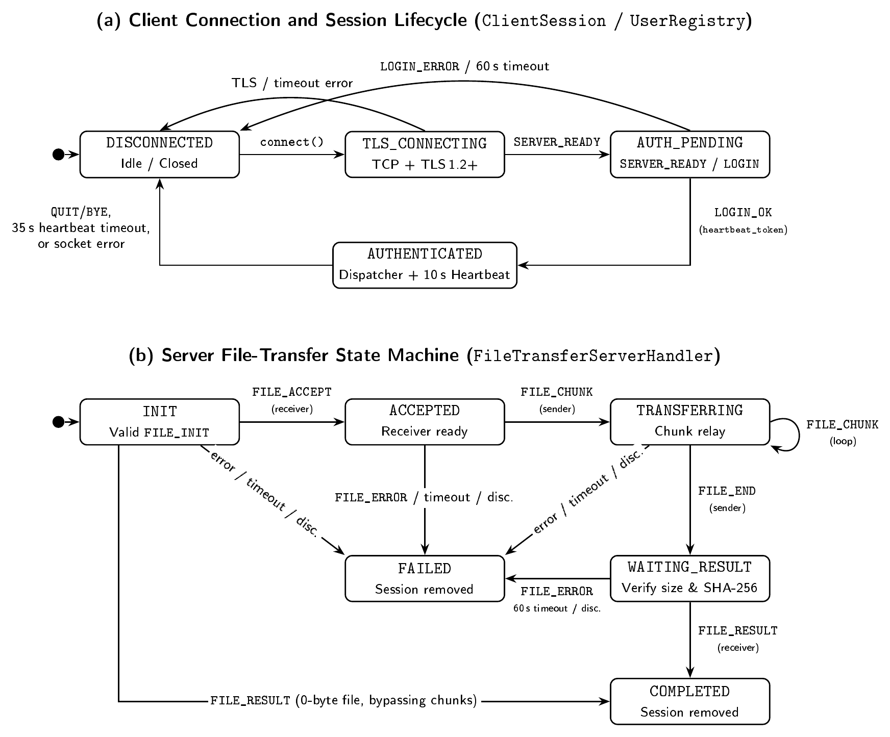

# Đặc tả Giao thức Truyền thông

Hệ thống sử dụng hai kênh truyền tải phối hợp: **TCP bọc TLS (`>= TLSv1.2`)** cho mọi nghiệp vụ điều khiển, chat, truyền file và **UDP** cho khám phá máy chủ LAN cùng giám sát trạng thái kết nối sống.

## 1. Đóng khung thông điệp TCP (TCP Framing)

Mỗi thông điệp trên kênh TCP/TLS có cấu trúc:

```text
+-------------------------------+----------------------------------------+
|  Length (4 bytes, big-endian) |   UTF-8 JSON Payload (Length bytes)    |
+-------------------------------+----------------------------------------+
```

- Độ dài `Length` là số nguyên không dấu chuẩn mạng (`!I`), giá trị tối đa `MAX_PAYLOAD_SIZE = 1048576` byte (`1 MB`).
- Payload JSON luôn là object có trường bắt buộc `"type"` dạng chuỗi không rỗng.

---

## 2. Giao thức kết nối, đăng nhập & tra cứu

| Hướng | Loại thông điệp (`type`) | Các trường chính | Mô tả |
| :--- | :--- | :--- | :--- |
| Server -> Client | `SERVER_READY` | `message` | Thông báo server sẵn sàng nhận `LOGIN` ngay sau TLS handshake |
| Client -> Server | `LOGIN` | `username` | Đăng nhập với tên 3–20 ký tự ASCII (`[A-Za-z0-9_]`) |
| Server -> Client | `LOGIN_OK` | `username`, `heartbeat_token` | Xác nhận đăng nhập thành công và cấp token bí mật cho UDP heartbeat |
| Server -> Client | `LOGIN_ERROR` | `code`, `message` | Từ chối đăng nhập (tên không hợp lệ hoặc bị trùng) |
| Client -> Server | `LIST_ONLINE` | — | Yêu cầu danh sách người dùng đang trực tuyến |
| Server -> Client | `ONLINE_LIST` | `users` | Danh sách username đang online (đã sắp xếp) |
| Client -> Server | `ECHO` | `text` | Gửi kiểm tra vòng lặp echo |
| Server -> Client | `ECHO_RESULT` | `text` | Phản hồi nội dung echo |
| Client -> Server | `QUIT` | — | Yêu cầu đóng phiên kết nối sạch |
| Server -> Client | `BYE` | `message` | Xác nhận đóng phiên theo yêu cầu `QUIT` |
| Server -> Client | `ERROR` | `code`, `message` | Báo lỗi yêu cầu không hợp lệ hoặc loại bản tin chưa hỗ trợ (`INVALID_TEXT`, `UNKNOWN_TYPE`) |

---

## 3. Giao thức Chat (Nhắn chung & Nhắn riêng)

- **Tin nhắn gửi lên Server:**
  - Chat chung: `{"type": "BROADCAST_MESSAGE", "text": "<nội dung>"}`
  - Chat riêng: `{"type": "DIRECT_MESSAGE", "recipient": "<username>", "text": "<nội dung>"}`
  - Ràng buộc nội dung: chuỗi UTF-8 hợp lệ, không rỗng và kích thước mã hóa `<= 65536` byte (`max_direct_message_bytes`).
- **Tin nhắn Server phân phối tới người nhận:**
  - `{"type": "BROADCAST_DELIVERY", "sender": "<username>", "text": "<nội dung>"}` (gửi tới mọi user online khác trừ người gửi).
  - `{"type": "DIRECT_DELIVERY", "sender": "<username>", "text": "<nội dung>"}` (gửi riêng cho `recipient`).
- **Phản hồi trạng thái tới người gửi (`DELIVERY_STATUS`):**
  - Chứa `ok` (`bool`), `message` (`str`), cùng `delivered_count` (khi broadcast thành công) hoặc `code` (khi thất bại).
  - Các mã lỗi `DELIVERY_STATUS`: `INVALID_RECIPIENT`, `RECIPIENT_SELF`, `INVALID_TEXT`, `MESSAGE_TOO_LARGE`, `RECIPIENT_OFFLINE`.
- **Signaling P2P cho Chat riêng 1–1 (tùy chọn khi bật chế độ P2P):**
  - `P2P_CHAT_OFFER` (`Sender -> Server -> Receiver`): đề nghị mở kênh TCP trực tiếp cho DM.
  - `P2P_CHAT_ACCEPT` (`Receiver -> Server -> Sender`): trả về `accepted` (`bool`), cùng `p2p_hosts`, `p2p_port`, `p2p_token` nếu chấp nhận; nếu `accepted=False` hoặc quá hạn, bên gửi tự fallback sang `DIRECT_MESSAGE` qua Server Relay và đồng bộ lại chế độ về `Client–Server`.

---

## 4. Giao thức Truyền tập tin (`FILE_*`)

Khi truyền trên kênh JSON chung, dữ liệu nhị phân của chunk được đóng gói qua trường `"binary_payload_base64"` (mã hóa Base64 chuẩn kiểm tra nghiêm ngặt khi giải mã).

### Danh sách thông điệp

| `type` | Hướng hợp lệ | Trường dữ liệu chính |
| :--- | :--- | :--- |
| `FILE_INIT` | Sender -> Server -> Receiver | `session_id`, `sender`, `receiver` (hoặc `recipient`), `filename`, `filesize`, `sha256`, `chunk_size`, `total_chunks`, `is_broadcast` *(tùy chọn, bool)* |
| `FILE_ACCEPT` | Receiver -> Server -> Sender | `session_id` |
| `FILE_CHUNK` | Sender -> Server -> Receiver | `session_id`, `chunk_index`, `binary_payload_base64` |
| `FILE_END` | Sender -> Server -> Receiver | `session_id` |
| `FILE_RESULT` | Receiver -> Server -> Sender | `session_id`, `status` (`"OK"` / `"FAILED"`), `reason` |
| `FILE_ERROR` | Hai chiều / Server | `session_id`, `code` (khi server phát), `reason` |

### Máy trạng thái phiên tại Server & Kiểm tra an toàn

- Vòng đời trạng thái hợp lệ trong `FileTransferServerHandler`:
  - Tập tin khác rỗng (`filesize > 0`): `INIT` --(`FILE_ACCEPT` bởi receiver)--> `ACCEPTED` --(`FILE_CHUNK` bởi sender)--> `TRANSFERRING` --(`FILE_END` bởi sender)--> `WAITING_RESULT` --(`FILE_RESULT` bởi receiver)--> `COMPLETED`. `FILE_RESULT` trước `FILE_END` bị từ chối bằng `ERR_INVALID_STATE`.
  - Tập tin rỗng (`filesize == 0`): Cho phép `FILE_RESULT` trực tiếp từ trạng thái `INIT` (hoặc `WAITING_RESULT`) để chuyển sang `COMPLETED`.
- Các thông điệp kết thúc (`FILE_RESULT`, `FILE_ERROR`) giải phóng ngay `ServerTransferSession` dưới khóa đồng bộ trước khi đẩy qua mạng; nếu chuyển tiếp một khung thất bại khi người nhận vẫn đang online, chỉ duy nhất phiên lỗi bị hủy mà không ngắt các phiên truyền file khác. Phiên không hoạt động quá `60` giây bị `prune_stale_sessions` thu hồi và báo `ERR_SESSION_TIMEOUT`.
- Server xác thực nghiêm ngặt: `session_id` hợp lệ (không rỗng, không khoảng trắng, không chứa `/`, `\`, `..`, `:`), `filename` là basename đơn hợp lệ, các trường số nguyên (`filesize`, `chunk_size`, `total_chunks`, `chunk_index`) phải là số nguyên nguyên bản không âm (`int`, loại trừ `bool`, `float` và chuỗi), trường tùy chọn `is_broadcast` phải có kiểu `bool` (trả `ERR_INVALID_METADATA` nếu sai kiểu), đồng thời ghi đè `header["sender"]` bằng danh tính kết nối TLS thực tế.



### Bảng mã lỗi truyền file (`FILE_ERROR`)

| Nhóm | Mã lỗi | Nguyên nhân |
| :--- | :--- | :--- |
| Phiên & Định tuyến | `ERR_INVALID_METADATA` | Metadata thiếu hoặc không hợp lệ (`session_id`, `receiver`, `filename`, `filesize`, `chunk_size`, `total_chunks`) |
| Phiên & Định tuyến | `ERR_RECIPIENT_SELF` | Người gửi đặt `receiver` trùng chính mình |
| Phiên & Định tuyến | `ERR_USER_OFFLINE` | Người nhận không trực tuyến hoặc gửi tới socket người nhận thất bại |
| Phiên & Định tuyến | `ERR_DUPLICATE_SESSION` | Trùng `session_id` đang hoạt động trên server |
| Phiên & Định tuyến | `ERR_SESSION_NOT_FOUND` | Phiên không tồn tại hoặc đã hết hạn |
| Phiên & Định tuyến | `ERR_UNAUTHORIZED_ROLE` | Sai vai trò gửi frame (ví dụ `FILE_ACCEPT` không do receiver gửi) |
| Phiên & Định tuyến | `ERR_INVALID_STATE` | Gửi thông điệp sai thứ tự máy trạng thái |
| Phiên & Định tuyến | `ERR_SESSION_TIMEOUT` | Phiên truyền quá thời gian chờ không hoạt động (60 giây) |
| Phiên & Định tuyến | `ERR_PEER_DISCONNECTED` | Đối tác mất kết nối TCP/heartbeat giữa phiên truyền |
| Giải mã payload | `ERR_CORRUPT_PAYLOAD` | Chuỗi Base64 payload hỏng không giải mã được |

> [!NOTE]
> Các lỗi kiểm tra ở phía `FileReceiver` (như sai thứ tự `chunk_index`, không khớp dung lượng, sai mã `SHA-256`, hoặc lỗi I/O ghi tệp đích) được báo qua `FILE_ERROR` (kèm `reason`) hoặc `FILE_RESULT` với `status="FAILED"` và mô tả trong trường `reason` (ngoài ra [common/message_types.py](../common/message_types.py) cũng định nghĩa sẵn các hằng số `ERR_HASH_MISMATCH`, `ERR_SIZE_MISMATCH`, `ERR_DISK_IO`).

---

## 5. Giao thức UDP Discovery & Signed Heartbeat

### Khám phá máy chủ (`UDP_DISCOVER` / `UDP_DISCOVERY_RESPONSE`)
- Client gửi broadcast/unicast: `{"type": "UDP_DISCOVER", "protocol_version": 1}` tới cổng UDP cấu hình (`5001`).
- Server phản hồi:
  ```json
  {
    "type": "UDP_DISCOVERY_RESPONSE",
    "protocol_version": 1,
    "tcp_port": 5000
  }
  ```
- Cả server (khi nhận `UDP_DISCOVER`) và client (khi nhận `UDP_DISCOVERY_RESPONSE`) đều kiểm tra `protocol_version` là số nguyên khớp cấu hình (loại trừ `bool` và `float`); client đồng thời kiểm tra `tcp_port` là số nguyên trong `[1, 65535]`.

### Duy trì phiên sống (`UDP_HEARTBEAT`)
- Mỗi client định kỳ gửi gói tin được ký bằng `heartbeat_token` (token bí mật do server cấp qua TLS khi `LOGIN_OK`):
  ```json
  {
    "type": "UDP_HEARTBEAT",
    "username": "<username>",
    "ts": 1794769200000,
    "sig": "<hmac_sha256_hex>"
  }
  ```
- Trong đó `ts` là timestamp hiện tại tính bằng mili-giây và chữ ký được tính bởi `HMAC-SHA256(heartbeat_token, "<username>:<ts>")`.
- Server chỉ làm mới phiên khi thỏa đồng thời:
  1. Sai lệch thời gian `|now_ms - ts| <= 30000` ms (`±30` giây).
  2. IP nguồn datagram trùng với IP kết nối TCP đã đăng nhập của `username`.
  3. `ts` tăng nghiêm ngặt so với heartbeat hợp lệ gần nhất (`ts > last_heartbeat_ts`) để chống replay attack.
  4. Chữ ký khớp định dạng 64 ký tự hex ASCII và trùng khớp theo so sánh thời gian hằng (`secrets.compare_digest`); chữ ký sai định dạng hoặc chứa ký tự non-ASCII bị loại bỏ an toàn mà không làm gián đoạn luồng UDP.
